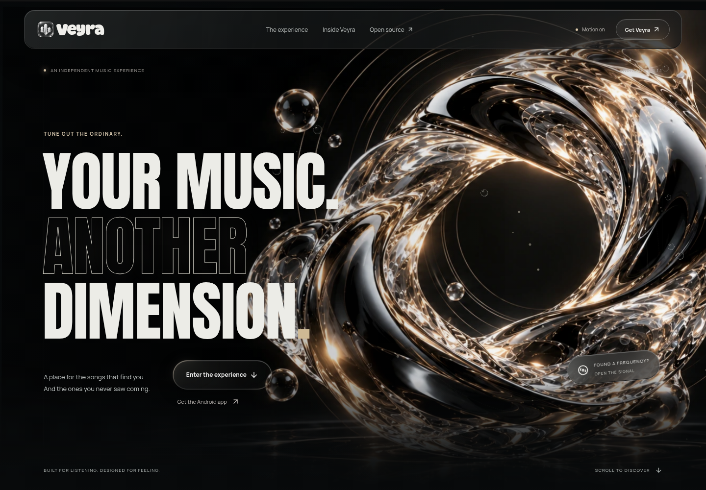
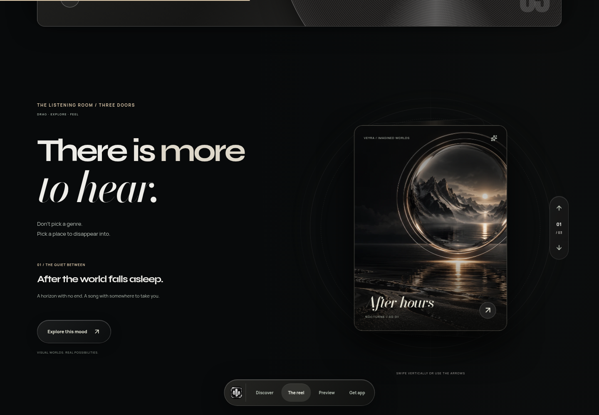

<div align="center">



# Veyra / Refraction Edition

**An independent Android music experience. An expressive web showcase.**

React · Motion · React Bits · GSAP · Tailwind · Original generated artwork

[Website source](https://github.com/Bhavishyadalal/Veyra-website) · [Experience](#the-experience) · [Preview locally](#preview-locally) · [Deploy](#deploy-your-website) · [Android app](https://github.com/Bhavishyadalal/Veyra)

</div>

## New: coordinated artwork and sharing cards

[Browse the media kit](public/media-kit/README.md). Twelve exports cover link previews, app banners, GitHub social preview, square/story posts, a transparent lockup and browser icons. Two newly generated liquid-glass backgrounds have full-resolution originals. The website footer opens `media.html`, an animated gallery with filters and image previews; `public/media-kit/index.html` also works offline by double-clicking it.

Sharing metadata is emitted into the initial HTML. No website URL is set because this site is not deployed yet. When the address is known, edit **`social.config.mjs` → `siteUrl`**, or set **`SITE_URL`** at build time, then rebuild. Vercel's production-domain variable is supported. Until then, the share image uses the public GitHub media-kit image and canonical/`og:url` are intentionally omitted. A real chat preview still needs a public website; local preview illustrations are not a WhatsApp fetch test.

Editable artboards: `tools/media-artboards.html`. Regenerate with `npm run media:render` (Playwright Chromium required), then `npm run media:gallery` and `npm run build`. The prepared exports work without regeneration.



## The experience — 4.1.0

The glass gateway was regenerated with sharper optical crystal, cleaner negative space and a more defined sculptural silhouette. A dedicated depth scene adds independently moving glass droplets, luminous dust, optical rings and a spring-driven pointer camera while leaving the reading layer still. Syne display headings and italic Bodoni Moda add a more expressive editorial rhythm.

A standalone website for the Veyra Android app, rebuilt around obsidian, smoked chrome, ivory and restrained amber light. It combines oversized Anton headlines, a Super Malibu signature, liquid-glass controls, and an editorial scroll story.

- A short curtain opening and staggered headline reveal, shown once per tab session.
- Four original generated artworks: a liquid-glass gateway, a lens over a black sea, a crystal orchid, and a suspended monolith. All are local WebP assets.
- Three React Bits **ScrollStack** chapters: Discover, Lyrics and Your Library. Native window scrolling, without wheel hijacking or mandatory snapping.
- React Bits **SpecularButton** pointer lighting and **FluxLines** magnetic fluid background.
- Official **SplitText TS/Tailwind**, **GlassSurface**, **GlareHover**, **DecryptedText** and **ShinyText** add animated typography, glass refraction, light sweeps, decoding text and metallic highlights.
- An original three-scene reel with Motion depth transitions, vertical drag/touch swipes, arrow-key/button navigation, and a direct handoff into the phone preview.
- A floating glass navigation dock, an atmospheric monolith scene, and a secret 73.0 MHz visual dial that unlocks the quiet archive.
- Four interactive phone screens: Home, Player, Lyrics and Library. Three moods change the artwork, track, accent and lyric text. A visual playback timer, seek control, like and next/previous controls respond to input.
- A hidden full-screen frequency scene, with keyboard dismissal and focus restoration.
- Responsive layouts from 320px upwards, a mobile menu, keyboard tabs, reduced-motion support and a persistent motion switch.
- Privacy/credits pages, local fonts, meaningful no-JavaScript fallback and a GitHub Actions build/browser workflow.

The phone is an **illustrative web preview inspired by Veyra**, not a running Android app or an actual screenshot. Artwork, tracks and lyric text are original demo content. No audio is streamed or played. Android release links point to GitHub; the source download is an Android Studio project, not an APK.

## Android download options

The download section offers GitHub releases and an alternate Google Drive folder, using a local three-color Drive icon and a glass button. The Drive option opens the supplied folder in a new tab so visitors can choose an APK; it is not presented as a direct APK file URL. Update the destination in `src/config.js` → `driveFolder`. Android Studio source remains a separate link.

## Preview locally

Clone this repository with `git clone https://github.com/Bhavishyadalal/Veyra-website.git`, then `cd Veyra-website`. If using the source ZIP, extract it and enter its `Veyra-Website` folder.

Install **Node.js 24 LTS** (minimum 22.12), extract the entire ZIP, then open a terminal in `Veyra-Website`, the folder containing `package.json`:

```sh
npm ci --include=dev
npm run dev
```

Open the address printed in your terminal. Stop with **Ctrl+C**. Windows users can double-click **START-WEBSITE.cmd**, which checks Node, installs the locked dependencies, and opens the preview. The launcher runs a clean dependency install so merging an older website folder cannot silently leave outdated libraries. For subsequent starts, `npm run dev` skips that setup step.

**`vite is not recognized`?** Run `npm ci --include=dev` first, in the folder containing `package.json`. Vite is a local project dependency; no global Vite installation is needed. Opening `index.html` as a file will not start this React project.

```sh
npm run typecheck
npm run build
npm run preview
```

## Deploy your website

This repository already contains the full website project at its root. To deploy later, import **Bhavishyadalal/Veyra-website** into Vercel:

| Setting               | Value                  |
| --------------------- | ---------------------- |
| Framework             | Vite                   |
| Node                  | 24.x                   |
| Install               | `npm ci --include=dev` |
| Build                 | `npm run build`        |
| Output                | `dist`                 |
| Environment variables | None required          |

The included `vercel.json` configures the static build and response headers. Privacy and credits are separately built HTML pages, so no single-page rewrite is necessary. This delivery does not publish or deploy the website.



## Source structure

```text
src/main.jsx                 Page, transitions, phone preview and hidden scene
src/Experience.jsx           Original reel, glass dock, monolith scene and tuning dial
src/DepthScene.jsx           Glass-particle renderer and pointer camera
src/components/              Official React Bits components + their CSS
src/config.js                Actual Android project/release/source links
src/styles/base.css          Base design system and responsive rules
src/styles/atmosphere.css    Obsidian/liquid-glass visual system and new scenes
src/styles/refraction.css   Refined typography, lighting and optical layers
public/brand/                Actual Veyra app icon
public/images/               Four original generated glass artworks
public/fonts/                Local typography and font notices
privacy.html, credits.html   Supporting pages
START-WEBSITE.cmd            Windows preview launcher
README.md, docs/             Setup, customization, provenance and validation
tests/                       Playwright and axe browser checks
```

## Motion and React Bits

The runtime uses `motion/react` for the opening, text reveals, scroll-linked artwork/progress, screen transitions, toast and hidden-scene motion. Motion AI Kit was installed with `npx motion-ai` in project scope during development; it is an authoring tool, not a runtime requirement or an included account configuration.

The eight public React Bits components are installed from their exact official registry source. `SplitText-TS-TW` is the actual TypeScript/Tailwind variant, with GSAP/ScrollTrigger and `@gsap/react` as its declared dependencies. Tailwind is compiled locally by its Vite plugin. `npm run typecheck` checks the TypeScript component.

The direct registry endpoint is blocked in the development environment, and shadcn using official local registry JSON fails when fetching its color metadata. We therefore installed the **exact `files[].content` from the official GitHub registry JSON**, preserving those components unchanged. See [component provenance](docs/COMPONENTS.md) for the source commit and hashes.

**About `@reactbits-starter/vertical-reel-tw`:** the official public manifest identifies it as the React Bits Pro Starter “Momentum Ring.” Its source requires a buyer’s licensed registry configuration. That paid source is not included or claimed as installed. This site instead has an independently written **FrequencyReel**, using Motion and the newly generated artwork. A licensed owner can integrate the official component later. No paid source or license key is bundled.

The effects work without Motion+, an API key, a paid account or a server. WebGL is optional: the image-based design, buttons and navigation remain usable if WebGL is unavailable. FluxLines is lazy-loaded, uses a capped pixel ratio, and its upstream visibility handling pauses animation offscreen or in a hidden tab. It is omitted entirely in reduced-motion mode. SplitText and its GSAP chunk load only when the reel approaches the viewport, and reduced-motion mode uses a plain complete heading. The depth canvas draws at approximately 30fps, caps its pixel ratio, and stops its frame loop offscreen or when the tab is hidden. Manual/system reduced motion leaves a still particle field and disables the pointer camera. The intro is brief and never blocks pointer access. Reduced motion also disables parallax, ticker, floating chip, vinyl rotation and chapter stacking transforms.

## Verification

```sh
npx playwright install chromium
npm test
```

Tests target the **production build**, so run `npm run build` first. CI does this automatically. For system Chromium:

```sh
PLAYWRIGHT_CHROMIUM_EXECUTABLE_PATH=/usr/bin/chromium npm test
```

See [validation](docs/VALIDATION.md) for the actual delivery checks and limits. Automated checks do not replace testing on your own physical Android/iOS devices.

## Customize

Edit real app links in `src/config.js`. Change moods and demo text in `src/main.jsx`; adjust tokens and breakpoints in `src/styles/atmosphere.css`. See [customization](docs/CUSTOMIZATION.md). Replace demo content with owned app screenshots if desired and update the illustrative-preview labels accurately.

## Credits and licenses

Veyra is a project by **Bhavishya Dalal**. Original website code is supplied under MIT; third-party code and assets keep their separate terms. React Bits uses **MIT + Commons Clause**, not plain MIT: its components are integrated into this website, not offered as a standalone component pack. Keep its included notice. GSAP and `@gsap/react` retain the GSAP Standard no-charge license (not MIT). Manrope, Anton, Syne and Bodoni Moda retain their OFL files. The supplied Super Malibu subset relies on the owner's recorded embedding and source redistribution permission. The Android source and associated brand assets retain their existing provenance and notices; this website does not relicense the Android app.

See [credits](credits.html), [component provenance](docs/COMPONENTS.md), [font provenance](docs/Super-Malibu-Provenance.md), and `docs/licenses/`.
